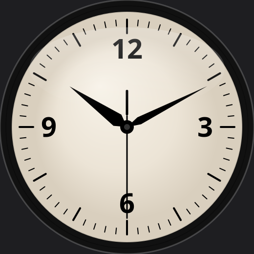

# Widgie Clock for Linux

A native Wayland port of [widgie-clock](https://github.com/ericlink/widgie-clock). It is the same floating analog face: no window frame, drawn above other windows, and click-through until you unlock it.

The clock is a [wlr-layer-shell](https://wayland.app/protocols/wlr-layer-shell-unstable-v1) overlay. It runs on Hyprland, Sway, and other wlroots compositors. It does not run on X11.

The launcher preloads `libgtk4-layer-shell` so its Wayland shim is installed before Python loads `libwayland`. That is required for the overlay when the library is used from Python.



## Requirements

- Python 3
- GTK 4, PyGObject, and PangoCairo (`gtk4`, `python-gobject`, `python-cairo`)
- [gtk4-layer-shell](https://github.com/wmww/gtk4-layer-shell)
- A StatusNotifier tray (the Omarchy bar has one)

On Arch:

```sh
sudo pacman -S gtk4 gtk4-layer-shell python-gobject python-cairo
```

## Run

```sh
./widgie-clock
```

Only one instance runs. A second launch does nothing.

The face starts in the top-right corner, just inside any bar, at 130px. That matches the Windows app.

## Tray menu

| Item | Action |
|------|--------|
| **Unlock to move** | Accept clicks and drag the face |
| **Lock (click-through)** | Let clicks pass through to the windows underneath |
| **Start at login** | Add or remove an XDG autostart entry |
| **Exit** | Quit |

Right-click the face while it is unlocked for the same menu. While it is locked, use the tray icon.

## Settings

`~/.config/widgie-clock/settings.json` (or `$XDG_CONFIG_HOME/widgie-clock/settings.json`):

```json
{
  "left": 3686,
  "top": 24,
  "size": 130,
  "locked": true,
  "startAtLogin": false,
  "monitor": "HDMI-A-1"
}
```

`left` and `top` are margins from the top-left corner of `monitor`, in logical pixels. The compositor adds a bar's exclusive zone on its own, so a `top` of 24 sits 24px below the bar. `size` is the window edge, from 80 to 600. A saved size of 260, the old Windows default, is migrated to 130. A copied Windows settings file is accepted: `startWithWindows` is read as `startAtLogin`.

## License

[MIT](LICENSE)
